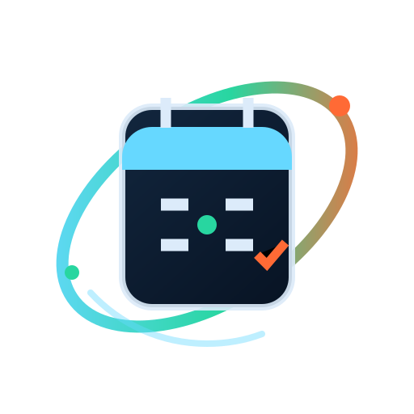

# Saldo Glasses

<p align="center"></p>

**Your finances at a glance on Meta Display Glasses.** Pair your glasses with your computer using a short code, then track the income, expenses, budgets and outstanding balances you enter yourself.

[Open Saldo](https://saldo-glasses.henning-orbit-calendar.workers.dev/) · [Glasses view](https://saldo-glasses.henning-orbit-calendar.workers.dev/glasses.html) · [Meta Display Apps](https://github.com/Henning1908)

Part of **Meta Display Apps** · [Orbit Calendar](https://orbit-calendar.henning-orbit-calendar.workers.dev/) · [WebUntis Glasses](https://webuntis-glasses.henning-orbit-calendar.workers.dev/)


---

## Your money, in view

Saldo shows the financial information you enter manually on your computer and glasses. It starts completely empty, with no sample data and no bank connection.

### Get started

1. In the Meta AI app, open **App connections → Add a Web App** and add `https://saldo-glasses.henning-orbit-calendar.workers.dev/glasses.html`.
2. Open Saldo on your Display Glasses. A six-digit code appears on the display.
3. Open the [Saldo web app](https://saldo-glasses.henning-orbit-calendar.workers.dev/) on your computer and enter the code. It expires after ten minutes.
4. Add transactions in the dashboard. The glasses view updates automatically.

## Features

- Add, edit and delete income or expenses with a category, group, date, payment method and description
- Enter amounts with a calculator keypad, including parentheses, percentages and operator precedence
- Prepare transactions with voice input; create groups by voice with an optional monthly budget
- Create and manage groups and custom income and expense categories
- View monthly and all-time results, category statistics, group spending and searchable transactions
- Set monthly budgets for groups and categories; track outstanding balances and partial repayments
- Schedule recurring transactions weekly, monthly or yearly
- Export transactions as CSV and back up or restore all app data as JSON
- View the monthly summary, latest transaction, groups and outstanding balances on glasses
- Use voice input in browsers that support the Web Speech API

## Meta Wearables app icon

Saldo provides a version 1 manifest at `/.well-known/meta-wearables-manifest.json`. It supplies the app name and cyan appearance. The icon is a transparent, monochrome SVG for the 64 × 64 icon area, as described in the [Meta Web Apps icon documentation](https://wearables.developer.meta.com/docs/develop/webapps/build/app-icons/).

## Privacy

- Saldo does not request bank details or connect to financial accounts.
- Financial data is encrypted before it is stored in Cloudflare D1.
- Glasses and computer are paired with a short-lived one-time code.
- The glasses receive only the financial summary shown in the app; they never need account credentials.
- This project is designed for personal use.

## Local development

```sh
npm install
npx wrangler d1 migrations apply saldo-glasses --local
npx wrangler dev
```

Create a `.dev.vars` file with a random `SALDO_ENCRYPTION_KEY` for the local Worker. For Cloudflare, run `npx wrangler secret put SALDO_ENCRYPTION_KEY`, then deploy with `npx wrangler deploy`.

## Meta Display Apps ecosystem

Saldo uses the same glasses-to-computer pairing flow as [WebUntis Glasses](https://github.com/Henning1908/WebUntis-Glasses) and joins the Meta Display Apps family around [Orbit Calendar](https://github.com/Henning1908/orbit-calendar-glasses).

[Source code on GitHub](https://github.com/Henning1908/Saldo-Glasses) · [Cloudflare Worker](https://saldo-glasses.henning-orbit-calendar.workers.dev/)
