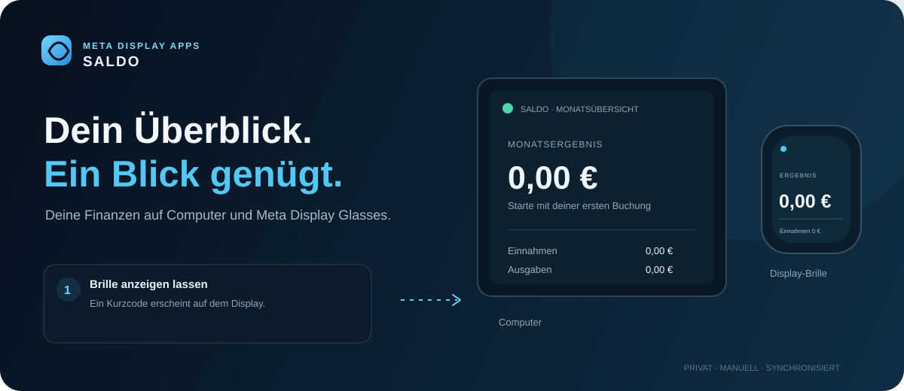

<div align="center">



# Saldo

### Your money, in one clear glance.

A personal finance companion for the web and Meta display glasses. Enter income, expenses, budgets and balances yourself, then keep the essentials in view.

[Open Saldo](https://saldo-glasses.henning-orbit-calendar.workers.dev/) · [English guide](https://saldo-glasses.henning-orbit-calendar.workers.dev/guide.html) · [Anleitung auf Deutsch](https://saldo-glasses.henning-orbit-calendar.workers.dev/guide.de.html)

Part of **Meta Display Apps** — explore [Orbit Calendar](https://orbit-calendar.henning-orbit-calendar.workers.dev/) and [WebUntis Glasses](https://webuntis-glasses.henning-orbit-calendar.workers.dev/).

[☕ Buy me a coffee](https://gofund.me/89190630b) · [Source code](https://github.com/Henning1908/Saldo-Glasses)

</div>

---

## Your money, in view

Saldo starts empty and tracks only the financial information you enter. It does not connect to banks. Use the web dashboard to manage your finances and the glasses view for a compact overview or quick transaction entry.

### Start in a minute

Open the [online setup guide](https://saldo-glasses.henning-orbit-calendar.workers.dev/guide.html) on your phone or computer. It covers adding Saldo to Meta display glasses, first-time pairing and the optional shared device registration.

1. Enable Developer Mode, then in the Meta AI app open **App Settings → Apps → Web Apps → Connect Web App** and add `https://saldo-glasses.henning-orbit-calendar.workers.dev/glasses.html`.
2. Open Saldo from the app grid on your glasses. If this device is not registered, a short-lived six-digit code appears.
3. Pair directly with Saldo using the code, or sign in to your [Meta Display Apps account](https://meta-display-apps.henning-orbit-calendar.workers.dev/) and enter it under **My account** to register the glasses once for the app family.
4. Enter transactions in Saldo. The glasses view updates automatically.

When you use one-time device registration, later apps can recognize the same glasses without another pairing code. Each app still has its own profile, settings and data.

## What Saldo does

| Feature | How it works |
| --- | --- |
| Income and expenses | Add, edit and search transactions with dates, categories, groups, payment methods and notes. |
| Budgets and balances | Set monthly limits, track money owed, and record partial repayments. |
| Recurring items | Schedule transactions weekly, monthly or yearly. |
| Insights | Review monthly and all-time totals, category statistics and group spending. |
| Glasses view | Check the current summary and latest transactions, or enter a new amount from the display. |
| Backup and export | Download CSV exports or a complete JSON backup and restore it later. |


## Privacy at a glance

- Saldo does not ask for bank details or connect to financial accounts.
- Finance records are encrypted before storage in Cloudflare D1.
- Pairing codes expire after ten minutes. Shared device registration stores a hashed device token in Meta Display Apps; app profiles remain separate.
- Glasses receive only the Saldo information needed for the display, never account credentials.
- Disconnect Saldo from Settings to remove its saved profile.

## Local development

```sh
npm install
npx wrangler d1 migrations apply saldo-glasses --local
npx wrangler dev
```

Create a `.dev.vars` file with a random `SALDO_ENCRYPTION_KEY`. To test shared account linking locally, configure `MDA_LINK_SECRET` to match the Meta Display Apps Worker. Never commit secret values, `.dev.vars` or files from `.wrangler/`.

For the hosted service, set the required Cloudflare Worker secrets and deploy with `npm run deploy`. See the maintainer documentation for [architecture](docs/ARCHITECTURE.md) and [Cloudflare deployment](docs/DEPLOYMENT.md).

## Meta Display Apps

Meta Display Apps is a small family of glanceable tools for Meta display glasses. Browse [Orbit Calendar](https://github.com/Henning1908/orbit-calendar-glasses) for calendar events and [WebUntis Glasses](https://github.com/Henning1908/WebUntis-Glasses) for your school timetable. Visit the [app directory](https://meta-display-apps.henning-orbit-calendar.workers.dev/) to explore all three.

Questions or ideas? Open an issue in this repository or read the [contribution guide](CONTRIBUTING.md). You can also [support the project](https://gofund.me/89190630b).

## License

Saldo Glasses is licensed under the [MIT License](LICENSE). Credit: **Henning1908**. The license does not grant rights to third-party trademarks.
